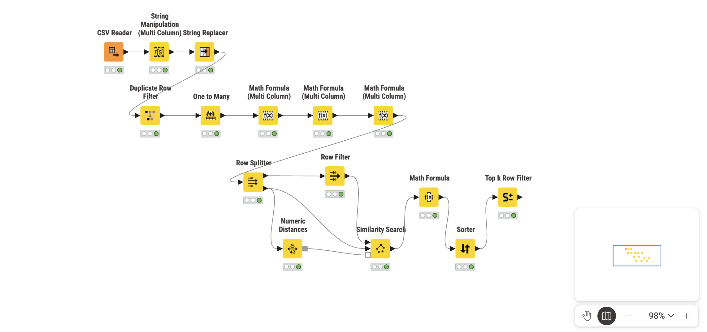
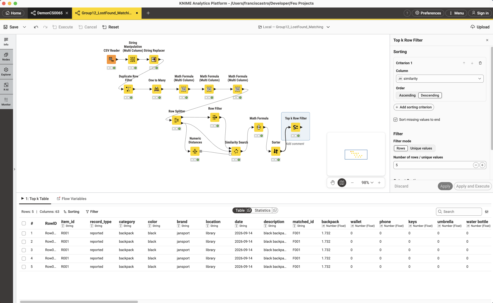
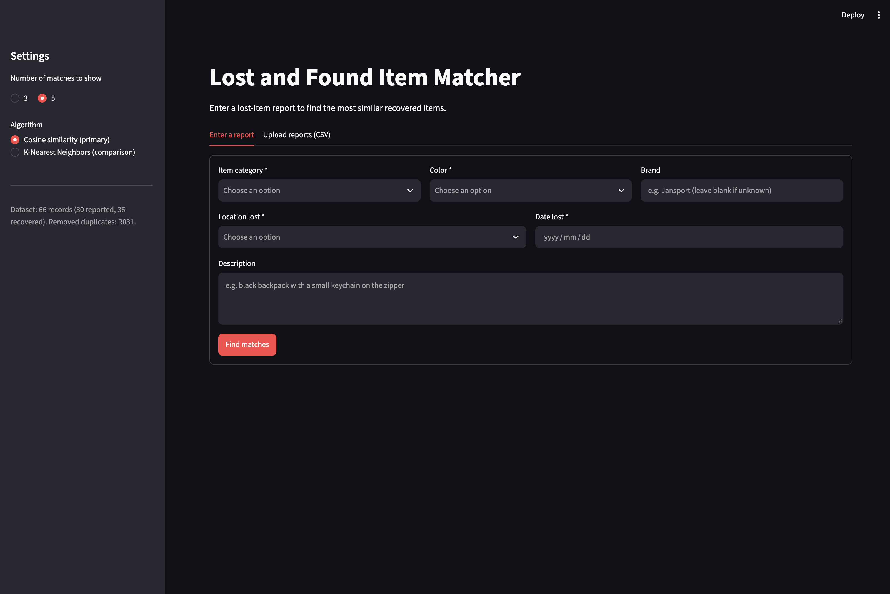
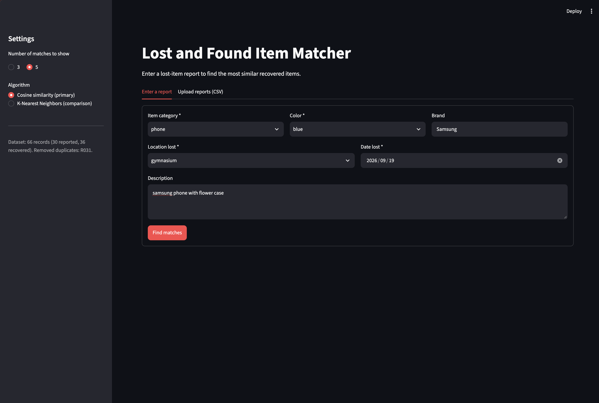
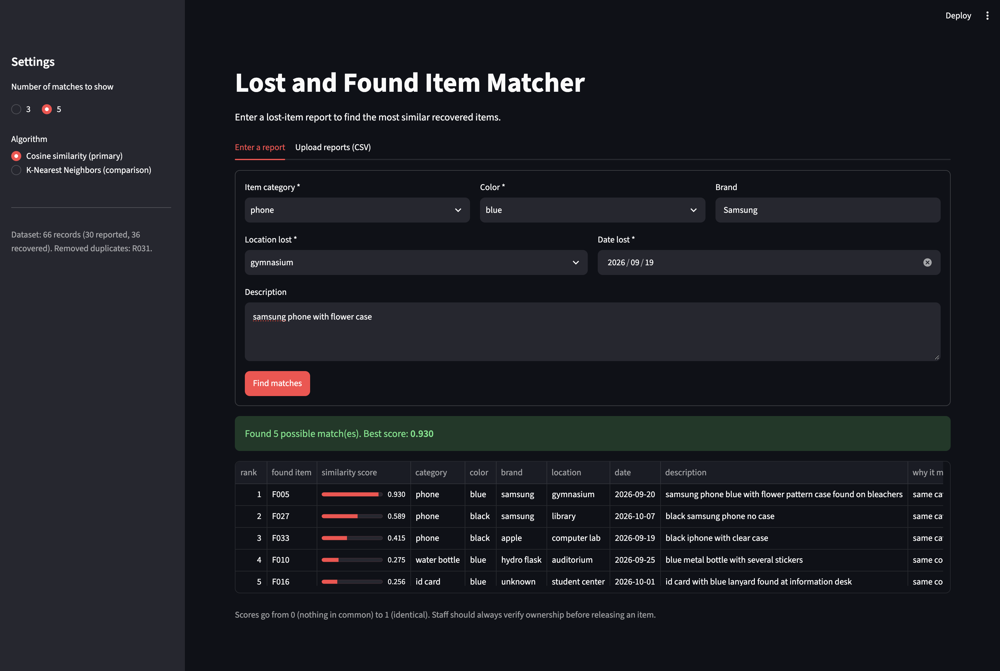
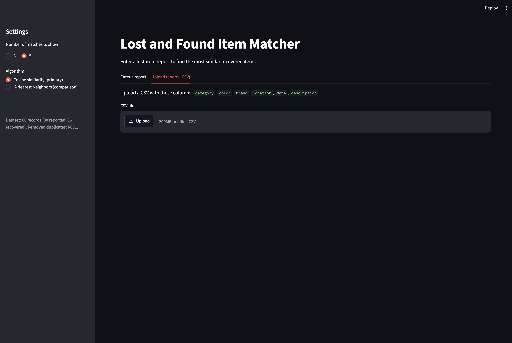
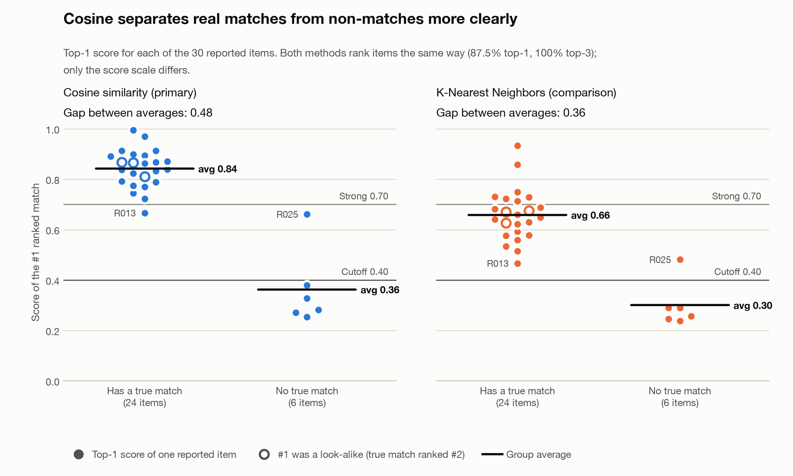

# Lost and Found Item Matching — Group 12 (CS0065 Midterm)

Prepared by: Castro, Calibjo, Valencia

- [Dataset](lost_found_dataset.csv)
- [Data dictionary](data_dictionary.md)
- [KNIME workflow](Group12_LostFound_Matching.knwf)
- [Python code](lost_found_matcher.py)
- [Streamlit app](app.py)
- [Evaluation report](part6_limitation_evaluation.md) / also available as [docx](part6_limitation_evaluation.docx)
- [Comparison chart](cosine_vs_knn_chart.png)
- [Screenshots](Screenshots/)

## Screenshots

**KNIME workflow**

**KNIME Top-k output**

**Streamlit interface**

**Streamlit input**

**Streamlit output**

**Streamlit upload**

## Results

| Measure                                  | Cosine (primary) | KNN (comparison) |
| ---------------------------------------- | :--------------: | :--------------: |
| Top-1 accuracy                           |      87.5%       |      87.5%       |
| Top-3 accuracy                           |       100%       |       100%       |
| Avg #1 score, reports with a true match  |      0.842       |      0.658       |
| Avg #1 score, reports with no true match |      0.362       |      0.300       |
| No-match reports correctly flagged       |      5 of 6      |      5 of 6      |

